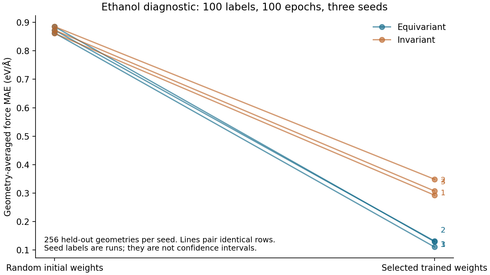

# Asterion

Asterion investigates whether geometric tensor representations improve force learning and
trajectory reliability under fixed molecular label budgets. Its original potentials predict
scalar energies. Coordinate gradients supply conservative forces to an original dynamics engine.

The supported domain is isolated neutral singlet molecules containing H, C, N and O. Labels from
different electronic structure methods belong to separate experiments. The full research campaign
and complete delivery requirements remain unmet. See [build status](docs/BUILD_STATUS.md).

## Development

```sh
make bootstrap
make doctor
make build
make test
make data
make train RUN_ID=my-diagnostic
make evaluate RUN_ID=my-diagnostic
make simulate RUN_ID=my-diagnostic
make demo RUN_ID=my-diagnostic
make diagnostic RUN_ID=my-diagnostic EVIDENCE=evidence/my-diagnostic
make verify RUN_ID=my-diagnostic EVIDENCE=evidence/my-diagnostic
make controls RUN_ID=my-diagnostic EVIDENCE=evidence/my-diagnostic
```

Install [uv](https://docs.astral.sh/uv/) before running these commands. The lock uses Python 3.12.14.
The default profile trains six CPU float64 models on ethanol with 100 labels each. Acquisition
downloads bounded, checksum-pinned rMD17 files. Dataset files and tensor checkpoints stay outside
Git. The demo writes `runs/my-diagnostic/viewer.html` and `failure-viewer.html`; both open locally.

## Observed diagnostic

Run `frozen-diagnostic-02` used execution commit `6e95f9544bf733981a4cb192acec6475cadb15cb`.
The original equivariant models achieved force MAE of 0.1111, 0.1316 and 0.1296 eV/angstrom on
256 held-out ethanol geometries per seed. This is an 84.9 to 87.1 percent reduction versus zero
force. The original invariant models achieved 0.2929, 0.3075 and 0.3488 eV/angstrom under the same
labels and selection rule. These are descriptive results on correlated geometries, without a
claim of a full cross-molecule comparison.

Nine learned NVE trajectories completed 250 steps at 0.1 fs, for 2250 executed steps. Independent
SI replay checked the integration. The diagnostic verifier replayed eight saved-weight probes per
trained run and independently recomputed physical labels and metrics. Full acceptance requires
larger populations, reference retraining, extended-molecule studies and complete coverage.



[Findings and raw figure tables](docs/FINDINGS.md) retain baselines, failures and limitations.
[Claim map](docs/CLAIMS.md) identifies evidence for each reported behavior.

## Mechanism and scope

Original radius graphs feed radial functions and e3nn representation primitives into original
scalar or O(3) tensor interactions. A scalar atomic readout sums to energy. Negative coordinate
gradients supply forces, including the double-backward path used during force-loss training.
An original Verlet/BAOAB engine integrates those forces and records detector termination.
Three separately trained models support finite-pool uncertainty/diversity acquisition.

[Architecture](docs/ARCHITECTURE.md), [model derivation](docs/MODEL.md),
[data card](docs/DATA.md), [model card](docs/MODEL_CARD.md),
[inference contract](docs/INFERENCE.md) and [source walkthroughs](docs/WALKTHROUGHS.md)
describe interfaces and assumptions. [Reproducibility](docs/REPRODUCIBILITY.md) lists commands,
and [benchmark methodology](docs/BENCHMARKS.md) defines measured work.

CPU float64 is the reference precision. The full profile requires a CUDA accelerator with at
least 16 GiB memory and verified force-loss double-backward. It cannot run on the available Apple
M2 host. The full coordinator is implemented; full execution and evidence coverage remain unverified.
Preflight records missing resources and unmet test populations, then exits nonzero. No release is certified and no hosted repository has been published.
