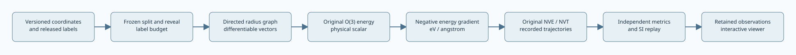

# Architecture

Coordinates and labels are separate interfaces. `CoordinatePool` exposes geometry and original
temporal identities. `LabelOracle` requires an explicit allowed row set and role. `Split` freezes
role membership; `RevealLedger` records acquisitions in a hash chain. The Python interface is an
information boundary for ordinary execution, not a security sandbox against malicious code.

`collate` flattens atom axes and preserves graph pointers. `RadiusGraph` produces directed edges
ordered by target then source. Distances remain differentiable; topology decisions do not.
`NeighborCache` owns only detached indices and coordinates from its last rebuild. Every call
recomputes vectors from the current differentiable positions.

The invariant model passes scalar edge messages. The equivariant model combines element scalars,
radial functions and spherical harmonics through learned tensor products. Whole-irrep scalar
gates preserve O(3). A quadratic invariant correlation adds a higher-order readout path.
Both models sum atomic energies, apply training-only physical normalization, then differentiate.

Training differentiates through the force loss. Checkpoints store tensors in safetensors and
optimizer structure in JSON. No pickle is loaded. Validation force MAE selects the checkpoint.
Evaluation rows never influence normalization or selection.

NVE uses velocity Verlet. NVT uses an original BAOAB Langevin composition and records its heat.
Detectors stop invalid geometry before force evaluation. An independent replay computes kinetic
energy from SI and reconstructs every completed step. It also records drift; low drift alone
does not establish an accurate molecular potential.

The viewer embeds retained observations. Source hashes, checkpoints, splits, unit counts and
raw predictions are verified independently before a diagnostic bundle is accepted. Full research
acceptance is a separate, currently incomplete obligation.

