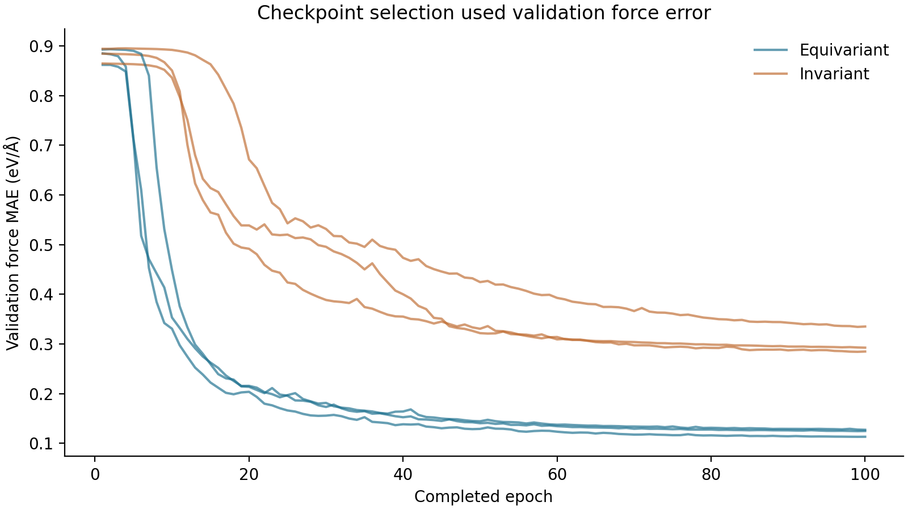
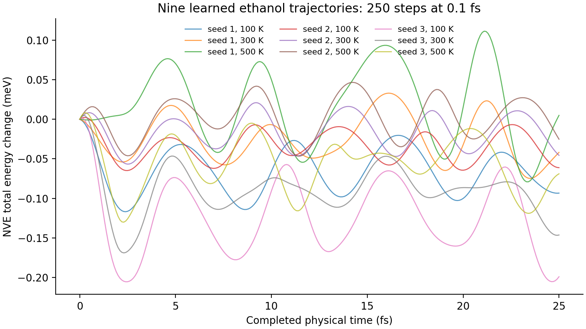

# Retained findings

These findings describe the CPU diagnostic, not full acceptance. Run `frozen-diagnostic-02` uses
execution commit `6e95f9544bf733981a4cb192acec6475cadb15cb` and source digest
`e94aeb4d5201d65c86d6514305f7b796d5fc2ce7bbae1eeff10f06b328433283`. All six models start from
random weights and train on 100 ethanol label pairs for 100 epochs, with 1300 optimizer updates
and 10,000 processed training examples per run. Processed examples count repeat epochs, not
additional unique labels. Validation force MAE selects the checkpoint.

## Held-out learning

Metrics average Cartesian force MAE inside each geometry, then across 256 held-out geometries.
Model comparisons within one seed use identical rows. The author-split protocol is correlated;
the seeds are not independent draws from a chemically broad population. No atom-wise confidence
interval or full paired block significance claim is made.

| Seed | Equivariant force MAE | Invariant force MAE | Zero-force MAE | Equivariant reduction |
| --- | ---: | ---: | ---: | ---: |
| 1 | 0.111071 | 0.292919 | 0.861581 | 87.11% |
| 2 | 0.131622 | 0.307542 | 0.871783 | 84.90% |
| 3 | 0.129603 | 0.348848 | 0.884777 | 85.35% |

Force units are eV/angstrom. Equivariant energy MAE is 0.033342, 0.040275 and 0.042543 eV.
Its random initial force MAE is 0.862141, 0.872431 and 0.884453 eV/angstrom. Trained scalar and
equivariant models improve over their initial weights and the zero-force baseline. The same-data
training-only mean-force baseline is 0.859666, 0.872312 and 0.889032 eV/angstrom.

The separate temporal held-out shift has 252, 255 and 251 remaining geometries after excluding all
primary training, validation, calibration and evaluation rows. Equivariant force MAE is 0.111220,
0.126896 and 0.128942 eV/angstrom; invariant force MAE is 0.291343, 0.295561 and 0.347858.
These outcomes do not establish arbitrary shift robustness or the required 5000-geometry protocol.

[Held-out table](figures/heldout.csv) and [input provenance](figures/PROVENANCE.json) identify the
model, seed, split and checkpoint. Each unit also retains raw `evaluation-predictions.npz`,
`evaluation-untrained.npz`, `evaluation-mean-force.npz` and `shift-predictions.npz`.

[Training table](figures/training.csv) contains all 600 completed epochs. Selection uses validation
only. Earlier pilot evaluation was inspected during development, so these results are a source-bound
engineering diagnostic and not an untouched final research test.

## Derivatives and symmetry

The selected seed-1 equivariant checkpoint passed 1200 randomized transformation/additivity trials,
1000 central energy-difference force checks and 100 directional force-difference Hessian checks.
Checks use the first eight retained genuine held-out geometries with deterministic perturbations;
1000 checks do not mean 1000 independently sampled molecular conformations.

Worst force absolute error was 2.118e-7 eV/angstrom and normalized error 4.281e-8. Worst Hessian
absolute error was 3.974e-6 in the checked directional force-derivative units and normalized error
8.275e-8. Force differences use a 1e-5 angstrom step; Hessian differences use 1e-4 angstrom.
Normalization divides by the larger compared norm with a 1e-8 floor. Independent metamorphic
checks include reflection, same-species permutation, translation, net force, torque, disconnected
additivity and batch reordering. These float64 checks do not establish accelerator precision.

Raw observations are `runs/frozen-diagnostic-02/derivatives/derivatives.json`. Generated graph tests
at `runs/validation-02/properties.json` contain 10,000 executed all-pairs comparisons.
Analytic dynamics at `runs/validation-02/analytic/analytic.json` contain 110 fixtures at three
timesteps with equal physical horizons, including independent oscillator and SciPy LJ references.

## Learned integration

Nine ethanol starts, three seeds at initial temperatures 100, 300 and 500 K, completed 250 steps at
0.1 fs. Every physical horizon is 25 fs, for 2250 completed learned integrations. Independent SI
replay reconstructs position, velocity and kinetic energy. All starts remain in the denominator.
Largest total NVE energy departure from its initial value was 0.000206 eV. This is a numerical
integration diagnostic, not a measured error against reference molecular dynamics.

[Trajectory table](figures/nve-drift.csv) contains 2259 frames, including nine initial frames.
Every row identifies the model checkpoint. Generated positions have no independent electronic
structure labels. Force overlays in the viewer compare only the released held-out geometries.
The real strict-force intervention fails at the initial learned evaluation and records
`extreme-force`, zero completed steps and the rejected candidate. The failure viewer preserves it.

## Acquisition and ablation integration outcomes

Run `acquisition-integration-02` exercised uniform, diversity-only and uncertainty-plus-diversity
policies at 8, 16 and 32 labels on one ethanol split. Each round trained three independently seeded
members for two epochs and retained calibration arrays, candidate scores, selections and reveal
chains. Exact label counts passed. Member held-out force MAEs remained 0.8621 to 0.8625 eV/angstrom,
close to the 0.862108 zero-force baseline. This is a negative learning result at the tiny workload.

Disagreement/error Spearman correlations ranged from 0.044 to 0.109 on 16 geometries. Coverage was
1.0 with mean bounds around 1.21 eV/angstrom. Broad coverage from a wide bound does not establish
useful error ranking. No acquisition policy was demonstrated to improve label efficiency.

Run `ablation-integration-02` executed angular orders 0 and 1, no quadratic higher-order readout,
hard cutoff and energy-only training for two epochs. Force MAEs ranged from 0.860233 to 0.862630.
The workload is too small to interpret these differences as architectural effects. The required
two-molecule, three-seed ablation study remains unexecuted.

The separate MD22 adapter check `secondary-integration-02` used 32 Ac-Ala3-NHMe labels, two epochs,
64 held-out geometries and two 16-step NVE starts. All 32 integration steps completed over 1.6 fs
per start. The force-error improvement over zero force was only 0.0113 percent, and energy MAE was
6.298 eV. Tiny drift with an almost untrained force does not establish physical accuracy.
`runs/secondary-integration-02/secondary/secondary.json` and the model/raw trajectory files retain
this negative result. No rMD17 checkpoint was used for the different PBE+MBD label level.

## Evidence scope

The diagnostic bundle independently verified all six saved model lineages, exact labels and units,
validation selection, raw metrics, 48 saved-weight held-out probes and retained trajectories.
All 16 disposable negative controls failed with specific verifier errors. Thirteen controls had
modified manifest hashes, so semantic corruption was checked beyond checksum rejection. Positive
verification passed before and after controls, and the valid bundle remained unchanged.

Full profile preflight recorded `blocked` because this host has no required CUDA accelerator.
The full assembly, authored-test population and research workloads are also unfinished. See
[known limitations](KNOWN_LIMITATIONS.md), [build status](BUILD_STATUS.md) and
[capability map](CAPABILITIES.md). No MACE result, full MD22 result, full acceptance or certified
release is claimed.
